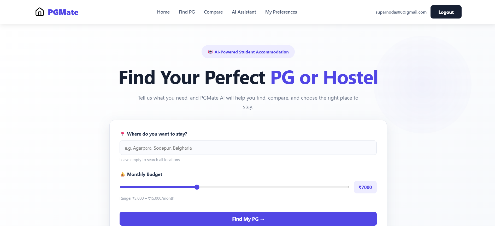
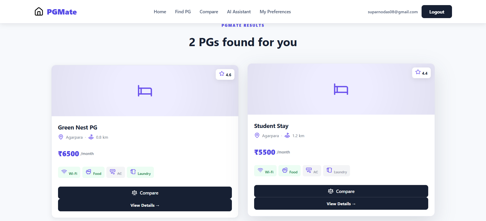
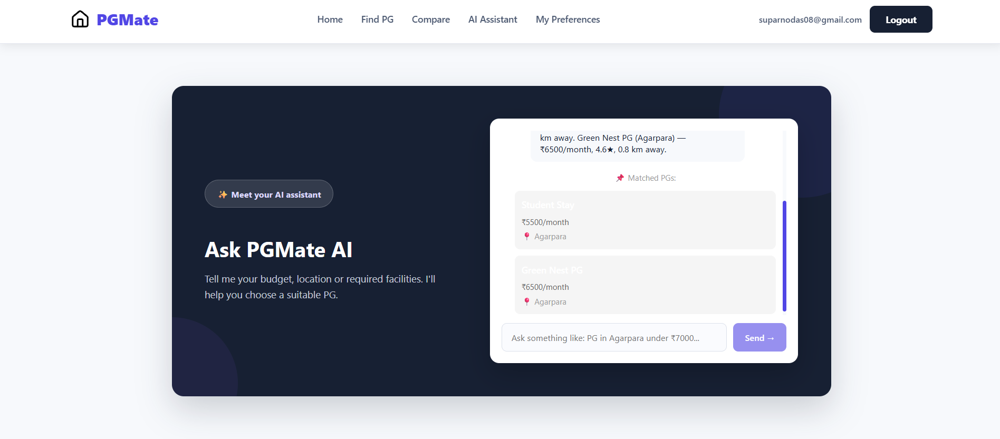
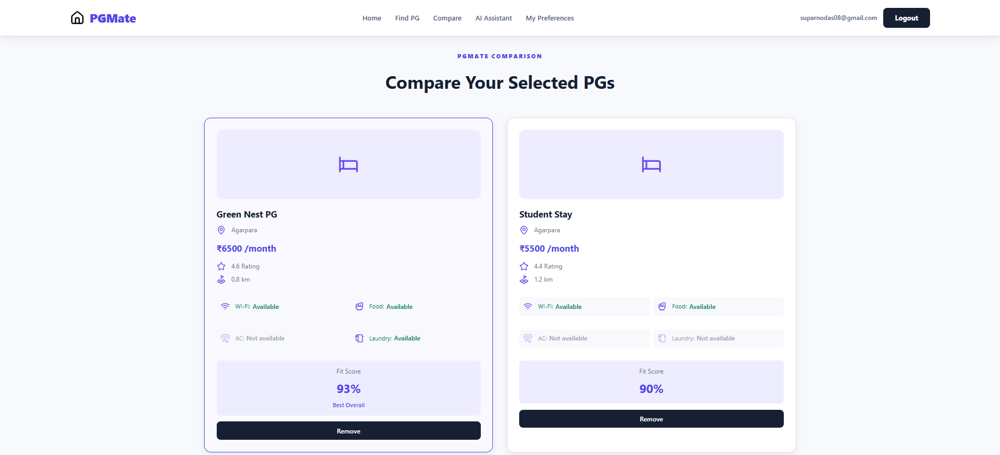

# 🏠 PGMate — Find Your Perfect PG or Hostel

**PGMate** is a PG and hostel discovery platform designed to help students find suitable accommodation based on their preferred location, monthly budget, and required facilities.

With a clean, responsive interface and an AI-powered recommendation assistant, PGMate makes finding a place to stay easier and more convenient.

<p align="center">
  <a href="https://pg-mate-ten.vercel.app/"><strong>🌐 Live Demo</strong></a> •
  <a href="https://github.com/Suparno08/PGMate"><strong>💻 GitHub Repository</strong></a>
</p>

---

## 🚀 Live Application

**Frontend:** https://pg-mate-ten.vercel.app/

**Backend API:** https://pgmate-api-n32e.onrender.com/

---

## ✨ Features

- 🔍 **PG Search:** Find PGs based on location and monthly budget.
- 🤖 **AI Assistant:** Get PG recommendations by describing your requirements in natural language.
- 💰 **Budget Filtering:** Discover accommodation within your preferred price range.
- 📍 **Location-Based Search:** Explore PGs in Agarpara, Sodepur, and Belgharia.
- ⚖️ **PG Comparison:** Compare multiple PGs based on rent, rating, distance, and facilities.
- 🏠 **Detailed PG Information:** View individual PG details and available amenities.
- 📱 **Responsive Design:** Optimized for desktop, tablet, and mobile devices.
- 🔐 **User Authentication:** Login and signup interface.
- ⭐ **Facility Information:** Check Wi-Fi, food, AC, and laundry availability.

## 🛠️ Tech Stack

| Technology | Purpose |
|---|---|
| React.js | Frontend UI |
| Vite | Frontend development and build |
| JavaScript | Application logic |
| CSS3 | Styling and responsive design |
| Node.js | Backend runtime |
| Express.js | REST API |
| SQLite (sql.js) | Database |
| Vercel | Frontend deployment |
| Render | Backend deployment |
| Git & GitHub | Version control |

## 🧠 AI Recommendation Assistant

PGMate includes an assistant that helps users find suitable PGs based on their requirements.

Users can describe:
- Preferred location
- Monthly budget
- Required facilities
- Accommodation preferences

The backend processes the request and returns matching PG recommendations from the available dataset.

## 📸 Screenshots

### 🏠 Home Page


### 🔍 PG Search Results


### 🤖 AI Assistant


### ⚖️ PG Comparison


## 📂 Project Structure

```text
PGMate/
│
├── src/
│   ├── api/
│   ├── assets/
│   ├── components/
│   ├── contexts/
│   ├── hooks/
│   ├── pages/
│   └── ...
│
├── server/
│   ├── server.js
│   ├── db.js
│   └── pgmate.json
│
├── public/
├── package.json
├── index.html
└── vite.config.js
```

## ⚙️ Run Locally

### 1. Clone the repository

```bash
git clone https://github.com/Suparno08/PGMate.git
```

### 2. Navigate to the project directory

```bash
cd PGMate
```

### 3. Install dependencies

```bash
npm install
```

### 4. Start the backend

Open a terminal:

```bash
npm run server
```

The backend will run at:

```text
http://localhost:5000
```

### 5. Start the frontend

Open another terminal:

```bash
npm run dev
```

The frontend will run at:

```text
http://localhost:5173
```

### 6. Production API Configuration

For production, configure the following Vercel environment variable:

```env
VITE_API_URL=https://pgmate-api-n32e.onrender.com
```

## 🔗 API Endpoints

| Method | Endpoint | Description |
|---|---|---|
| GET | `/health` | Backend health check |
| GET | `/api/pgs/search` | Search PGs by location and budget |
| GET | `/api/pgs/:id` | Get PG details |
| POST | `/api/pgs/batch` | Fetch multiple PG records |
| GET | `/api/preferences` | Retrieve user preferences |
| PUT | `/api/preferences` | Update user preferences |
| POST | `/api/assistant` | Get PG recommendations |

## 📍 Available Demo Locations

Currently, the application includes sample PG listings from:

- Agarpara
- Sodepur
- Belgharia

*Note: The current listings are demo data for project demonstration purposes and are not verified real-world accommodation listings.*

## 👥 Team — Null Pointers

**Project: PGMate**

| Name | Role |
|---|---|
| Suparno Das | Team Member |
| Supradip Paul | Team Member |
| Soumyadeep Biswas | Team Member |

## 🎓 Project Information

Developed as a collaborative project under the **PixelBits** team.

## 📄 License

This project is developed for educational and demonstration purposes.

---

<p align="center">
  <strong>Made with ❤️ by Null Pointers — PixelBits</strong>
</p>
