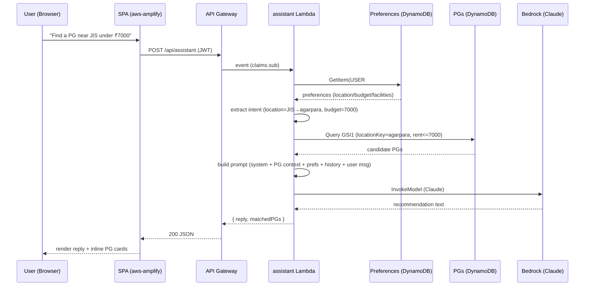
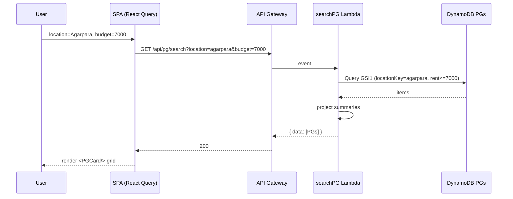
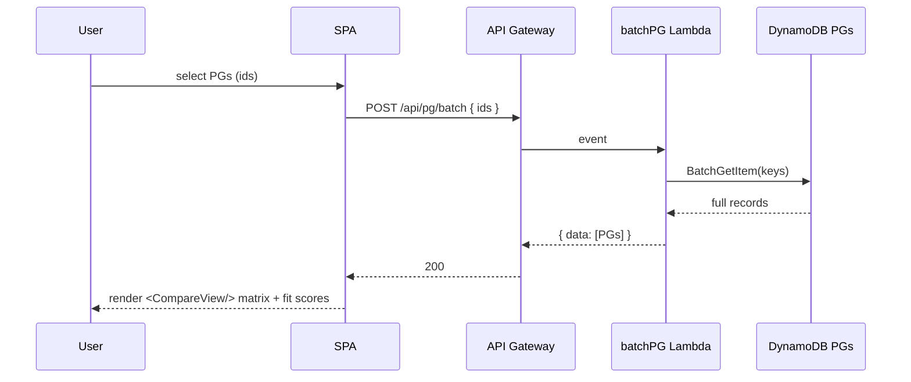
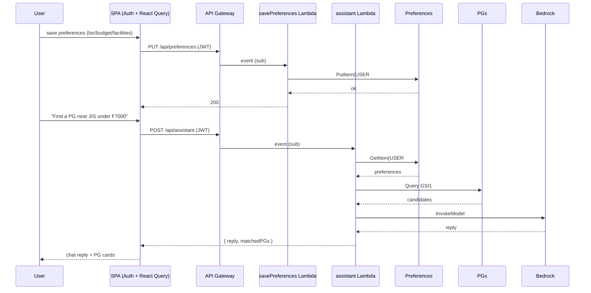
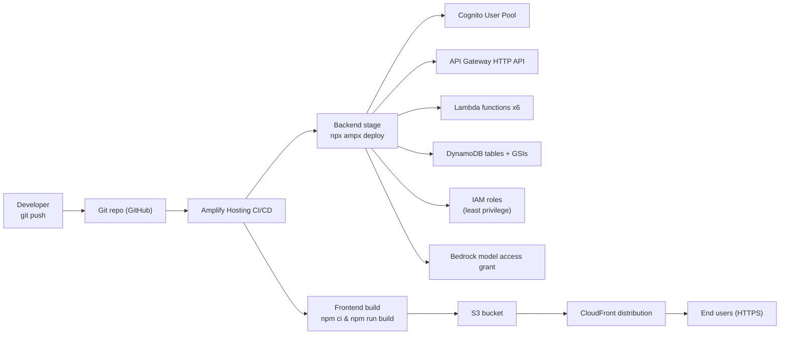

# PGMate — Technical Design

> Built for the **"Build with Kiro" Serverless Challenge**.
> Source of truth for requirements: `src/requirements.md`. This design is derived strictly from that specification.

| Field | Value |
|---|---|
| Project | PGMate — AI-powered student PG/hostel discovery platform |
| Frontend stack | React 19 + Vite 8 + oxlint (existing SPA in `src/App.jsx`) |
| Backend stack | Serverless on AWS: Cognito, API Gateway, Lambda, DynamoDB, Bedrock, Amplify |
| IaC / orchestration | AWS Amplify Gen 2 (TypeScript) with CDK escape hatch |
| Constraints | Do **not** modify the existing frontend code in this phase; this document defines the target architecture only. |

---

## 0. Scope and Non-Goals

**In scope (from requirements):** PG search by location + budget, budget filter, PG listings, PG comparison, AI assistant recommendations, Cognito auth (sign up / log in / log out), user preferences, serverless data store, live cloud deployment.

**Explicitly out of scope for this design:** payments, booking/availability calendars, owner-side dashboards, multi-image upload pipelines, reviews/comments threads, advanced geospatial search. These are noted as future enhancements where relevant.

**Guiding principle:** Every requirement in `src/requirements.md` §4 must map to at least one component in this design. Every AWS service listed here must trace back to a concrete requirement.

---

## 1. Overall System Architecture

PGMate is a single-page React application hosted on a CDN edge, talking to a stateless REST API backed by AWS Lambda. All persistence lives in DynamoDB. Authentication is handled by Amazon Cognito. The AI assistant is powered by Amazon Bedrock, invoked from a Lambda that first retrieves relevant PG data from DynamoDB to ground its answers (retrieval-augmented generation).

```mermaid
flowchart LR
  subgraph Client["Client (Browser)"]
    SPA["React 19 + Vite SPA<br/>aws-amplify v6"]
  end
  subgraph Edge["Hosting & Edge"]
    CF["CloudFront"]
    S3["S3 (static assets)"]
  end
  subgraph AuthN["Authentication"]
    COG["Amazon Cognito<br/>User Pool"]
  end
  subgraph API["API Layer"]
    AGW["API Gateway HTTP API<br/>JWT authorizer"]
  end
  subgraph Compute["Compute (AWS Lambda)"]
    L1["searchPG"]
    L2["getPG"]
    L3["batchPG"]
    L4["getPreferences"]
    L5["savePreferences"]
    L6["assistant"]
  end
  subgraph Data["Data & AI"]
    DDB["DynamoDB<br/>PGs + Preferences"]
    BR["Amazon Bedrock<br/>(Claude)"]
  end

  SPA -->|REST / HTTPS| AGW
  SPA -->|Auth: signUp / signIn / tokens| COG
  AGW -->|routes (JWT-validated)| L1
  AGW --> L2
  AGW --> L3
  AGW --> L4
  AGW --> L5
  AGW --> L6
  L1 --> DDB
  L2 --> DDB
  L3 --> DDB
  L4 --> DDB
  L5 --> DDB
  L6 --> DDB
  L6 -->|InvokeModel| BR
  CF --> S3
  SPA -. hosted and served by .-> CF
```

### AWS service inventory (purpose + connections)

| Service | Purpose (which requirement) | Connects to |
|---|---|---|
| **AWS Amplify (Gen 2)** | Defines & deploys the backend (Cognito, Lambda, DynamoDB, API), and hosts the SPA via CI/CD (§4.7, §deployment). | Cognito, Lambda, DynamoDB, API Gateway, CloudFront, S3 |
| **Amazon Cognito (User Pool)** | Authentication: sign up / log in / log out, issues JWTs (§4.7). | API Gateway (JWT authorizer), SPA (Amplify Auth), Lambda (reads `sub`/`email` claims) |
| **API Gateway (HTTP API)** | Public REST entry point; validates Cognito JWT before invoking Lambdas (§4.1–4.6). | Cognito (authorizer), all Lambda functions |
| **AWS Lambda** | Serverless business logic: search, fetch, compare, preferences, AI orchestration (§4.1–4.8). | DynamoDB, Bedrock, API Gateway |
| **Amazon DynamoDB** | Serverless data store for PG records and user preferences (§5, §4.8). | Lambda functions |
| **Amazon Bedrock** | Serverless LLM (Claude) for the AI assistant recommendations (§4.6). | `assistant` Lambda only |
| **Amazon S3 + CloudFront** | Static hosting of the built Vite SPA, globally cached (deployment). | Amplify Hosting → S3 → CloudFront → browser |
| **AWS IAM** | Least-privilege execution roles for each Lambda (security). | All compute & data services |
| **Amazon CloudWatch** | Logs, metrics, alarms, optional tracing for Lambdas & API (ops). | Lambda, API Gateway, Bedrock (via CloudWatch Logs) |
| **AWS WAF (optional)** | Rate limiting / abuse protection on the public API (security). | API Gateway |

**Request lifecycle (typical search):** Browser → CloudFront (static) + API Gateway (data) → Lambda → DynamoDB → response → React renders.

---

## 2. Frontend Architecture

The existing `src/App.jsx` is a single React 19 component holding all state with `useState` and using hardcoded `pgData`. The design **keeps this file untouched in the current phase** but defines the target modular structure the app grows into.

### 2.1 Stack and conventions
- **Build:** Vite 8 (`npm run dev`, `npm run build`). **Lint:** oxlint (`npm run lint`).
- **Routing:** introduce `react-router-dom` for named routes once the backend exists. Proposed routes: `/` (home/search), `/results`, `/pg/:id`, `/compare`, `/assistant`, `/login`, `/signup`, `/preferences`. Until then, the current anchor-based single page is preserved.
- **Server state:** `@tanstack/react-query` for PG search/fetch/preferences (caching, retries, loading/error states). Replaces ad-hoc `useState` fetch state.
- **Auth state:** `aws-amplify` v6 `Auth` API wrapped in a small `AuthContext` (`useAuth` hook: `user`, `signIn`, `signUp`, `signOut`, `isLoading`).
- **Styling:** keep the existing `App.css` approach; extract component-scoped styles only when components are split out.

### 2.2 Component decomposition (target)
Current `App.jsx` sections map to future components:

| Current section (in `App.jsx`) | Target component | Responsibility |
|---|---|---|
| Navbar | `<Navbar/>` | brand, nav links, auth-aware Login/Logout button |
| Hero + search card | `<Hero/>` + `<SearchCard/>` | location + budget inputs → calls search API |
| Search results | `<ResultsSection/>` + `<PGCard/>` | renders PG summaries from API |
| PG details modal | `<PGDetails/>` | fetches + shows full PG record, contact CTA (auth-gated) |
| Compare | `<CompareView/>` | side-by-side table from batch fetch |
| Features | `<Features/>` | static marketing (unchanged) |
| AI assistant | `<AssistantChat/>` | chat UI + POST to assistant API; renders returned PG cards inline |

### 2.3 Amplify integration (frontend)
- `aws-amplify` v6 modules: `signIn`, `signUp`, `signOut`, `fetchAuthSession` from `aws-amplify/auth`; `client` REST methods from `aws-amplify/api`.
- Configuration sourced from `amplify_outputs.json` (generated by `npx ampx generate outputs`), imported at app bootstrap — no hard-coded endpoint URLs or IDs in code.
- The REST client automatically attaches the Cognito JWT as the `Authorization: Bearer` header for authenticated calls.

---

## 3. AWS Serverless Architecture

The backend is fully serverless: no EC2, no containers, no always-on servers. Compute is Lambda, data is DynamoDB, the model is Bedrock, the edge is CloudFront, identity is Cognito. Pay-per-use, auto-scaling, zero idle cost.

**Why these services (requirement traceability):**
- **API Gateway + Lambda** → "Store PG and user data using serverless AWS services" (§2) and all of §4.1–4.6.
- **DynamoDB** → "maintain PG accommodation records" (§5) and "store ... preferences" (§4.8).
- **Cognito** → "Authentication should be implemented using Amazon Cognito" (§4.7).
- **Bedrock** → "AI assistant ... use available PG information when generating recommendations" (§4.6).
- **CloudFront + S3** → "Deploy the application as a live cloud application" (§2).

**Compute model:** each API route maps to one Lambda function, packaged individually (small cold-start surface, clear blast radius). All Lambdas use the AWS SDK v3, run Node.js 20.x, are configured with provisioned concurrency only if latency targets demand it (default: on-demand invocations). Environment variables (table names, Bedrock model id, region) are injected by Amplify from the backend definition.

**Data access model:** Lambdas never expose raw DynamoDB access to the browser. All reads/writes go through validated Lambda handlers. This keeps the data model private and gives a single place to enforce input validation and authz.

---

## 4. AWS Amplify

Amplify serves three distinct roles in PGMate. Each is a different facet of the product; they are intentionally kept separate.

### 4.1 Backend definition (Amplify Gen 2)
The backend is defined in TypeScript via `@aws-amplify/backend`:
- `amplify/backend/auth/resource.ts` — `defineAuth` → Cognito User Pool (email sign-in, no Identity Pool required for the API path).
- `amplify/backend/functions/<name>/resource.ts` — `defineFunction` per Lambda (searchPG, getPG, batchPG, getPreferences, savePreferences, assistant).
- `amplify/backend/data/...` — DynamoDB tables and GSIs defined via the **CDK escape hatch** (`a.custom` / raw CDK constructs), because Amplify's first-class data construct is GraphQL/AppSync and the requirements call for explicit Lambda + DynamoDB + REST. The escape hatch yields plain DynamoDB tables owned by the Amplify stack.
- `amplify/backend/api/resource.ts` — API Gateway HTTP API with routes bound to the functions above and a JWT authorizer pointing at the Cognito user pool.
- `amplify/backend.ts` — `defineBackend` wires auth, functions, data, and api together and grants IAM permissions (`assistant` → `bedrock:InvokeModel`; data functions → scoped DynamoDB table/index access).

### 4.2 Frontend libraries (`aws-amplify` v6)
Consumed by the React SPA for **auth** (`aws-amplify/auth`) and **REST calls** (`aws-amplify/api`). Configured from the generated `amplify_outputs.json`. This is the "glue" between Cognito, the SPA, and the API — no hand-rolled JWT handling needed.

### 4.3 Hosting (Amplify CI/CD)
Git-connected Amplify Hosting builds and deploys the SPA: `npm ci && npm run build` → artifacts to S3 → distributed via CloudFront. Branch-based environments map `main` → production, a `dev` branch → staging. The same pipeline can run `npx ampx deploy` to update the backend on push (see §16).

---

## 5. Amazon Cognito Authentication

A **Cognito User Pool** is the identity provider. Email-based sign-up, password per Cognito policy, optional MFA toggled off for the challenge demo but available.

**Flow (requirement §4.7):**
1. **Sign up** — `Auth.signUp({ username: email, password, options: { userAttributes: { email } }})`. Cognito sends a verification code; `Auth.confirmSignUp` verifies.
2. **Log in** — `Auth.signIn({ username, password })` → Cognito issues ID, Access, and Refresh JWTs. Amplify stores them (localStorage / in-memory) and refreshes automatically.
3. **Log out** — `Auth.signOut()` clears tokens.
4. **Session** — `Auth.getCurrentUser()` / `fetchAuthSession()` exposes `user.sub` and `tokens.accessToken`.

**Connecting to the API:** the SPA requests protected endpoints via the Amplify REST client, which injects `Authorization: Bearer <access-token>`. API Gateway's **JWT authorizer** (configured against the User Pool) validates issuer + audience + expiry before the Lambda runs. The Lambda reads `event.requestContext.authorizer.claims.sub` to identify the user — **no password or secret ever reaches Lambda or the API**.

**Identity Pool:** not required because all AWS access is brokered by Lambda (no direct browser-to-DynamoDB). It can be added later if the SPA needs direct, scoped AWS resource access.

**Groups (future):** a Cognito group `admins` could gate a PG-management API for owners — out of scope now but the model supports it.

---

## 6. API Design

REST over HTTPS, JSON in/out. All responses share a consistent envelope. Public routes require no token; protected routes require a valid Cognito JWT.

### 6.1 Endpoints

| Method | Path | Auth | Lambda | Purpose (req) |
|---|---|---|---|---|
| `GET` | `/api/pg/search?location=&budget=&facilities=` | Public | `searchPG` | Search PGs by location + budget, optional facilities filter (§4.1, §4.2, §4.3) |
| `GET` | `/api/pg/{id}` | Public | `getPG` | Single PG detail (§4.4) |
| `POST` | `/api/pg/batch` | Public | `batchPG` | Fetch multiple PGs for comparison (§4.5) |
| `GET` | `/api/preferences` | Cognito JWT | `getPreferences` | Read current user's preferences (§4.8) |
| `PUT` | `/api/preferences` | Cognito JWT | `savePreferences` | Upsert current user's preferences (§4.8) |
| `POST` | `/api/assistant` | Cognito JWT | `assistant` | AI assistant reply with grounded PG data (§4.6) |

`POST /api/pg/batch` body: `{ "ids": ["p1","p2","p3"] }` → `{ "pgs": [ {...}, {...} ] }`.
`POST /api/assistant` body: `{ "message": "Find a PG near JIS under ₹7000", "history": [ {role,text}... ] }` → `{ "reply": "...", "matchedPGs": [ {...} ] }`.

### 6.2 Response envelope (success)
```json
{ "data": { ... }, "requestId": "uuid" }
```
List endpoints wrap as `{ "data": [ ... ], "requestId": "..." }`.

### 6.3 Error envelope
```json
{ "error": { "code": "VALIDATION_ERROR", "message": "budget must be between 1000 and 100000", "requestId": "uuid" } }
```
Status codes: `200` success · `400` validation · `401` missing/invalid token · `403` valid token but not allowed · `404` not found · `429` throttled · `500` internal.

### 6.4 Validation contract (server-side, enforced in every Lambda)
- `location`: optional, string, max 100 chars, trimmed, lowercased before use.
- `budget`: optional integer, clamped to `[1000, 100000]`.
- `facilities`: optional, must be subset of `["wifi","food","ac","laundry"]`.
- `ids`: array, length 1–4, each ULID-shaped.
- `message`: required, max 1000 chars for the assistant.

---

## 7. AWS Lambda Functions

All functions: Node.js 20.x, AWS SDK v3, single responsibility, stateless, idempotent where possible, structured JSON logging with a `requestId` correlation id.

| Function | Trigger | Input → Output | Data access | Notes |
|---|---|---|---|---|
| **searchPG** | `GET /api/pg/search` | query params → PG summary list | DynamoDB Query on GSI1 (location+rent) or GSI2 (rent only), optional FilterExpression on facilities | Pagination via `Limit` + `LastEvaluatedKey` |
| **getPG** | `GET /api/pg/{id}` | path param → single PG | DynamoDB `GetItem` PK=`PG#{id}` | 404 if missing or status≠ACTIVE |
| **batchPG** | `POST /api/pg/batch` | ids[] → PG[] | DynamoDB `BatchGetItem` (keys `PG#{id}`) | Caps at 4 ids for compare UX |
| **getPreferences** | `GET /api/preferences` | JWT sub → preferences or null | DynamoDB `GetItem` PK=`USER#{sub}` | Returns `null`/defaults if no record |
| **savePreferences** | `PUT /api/preferences` | JWT sub + body → saved | DynamoDB `PutItem` (upsert by `USER#{sub}`) | Validates fields, sets `updatedAt` |
| **assistant** | `POST /api/assistant` | message + JWT → reply + matchedPGs | DynamoDB Query (intent-based) + `GetItem` (preferences) + Bedrock `InvokeModel` | See §11 for full flow |

**IAM grants (least privilege):**
- `searchPG`, `getPG`, `batchPG` → `dynamodb:Query/GetItem/BatchGetItem` on `PGs` table and its GSIs only.
- `getPreferences`, `savePreferences` → `dynamodb:GetItem/PutItem` on `Preferences` table only (scoped to the user's partition key via conditions where feasible).
- `assistant` → read on both tables **and** `bedrock:InvokeModel` on the specific model ARN only.

---

## 8. DynamoDB Data Model

Two single-purpose tables, on-demand capacity (no provisioning to manage), point-in-time recovery enabled.

### 8.1 Table `PGMatePGs` (PG accommodation records — req §5)
Partition key only at base table; access patterns served via GSIs.

| Attribute | Type | Notes |
|---|---|---|
| `PK` | String | `PG#{id}` (id = ULID) |
| `id` | String | ULID, mirrored for convenience |
| `name` | String | PG name |
| `location` | String | original case, e.g. `Agarpara` |
| `locationKey` | String | lowercased, e.g. `agarpara` — GSI partition key |
| `rent` | Number | monthly rent in INR — GSI sort key |
| `distanceKm` | Number | numeric distance, e.g. `0.8` (UI formats `0.8 km`) |
| `rating` | Number | e.g. `4.6` |
| `description` | String | basic description |
| `facilities` | Map | `{ "wifi": true, "food": true, "ac": false, "laundry": true }` |
| `facilityKeys` | String Set | `["wifi","food"]` — for FilterExpression `contains` |
| `contact` | Map | `{ "name", "phone", "email" }` — returned only to authenticated callers |
| `status` | String | `ACTIVE` / `INACTIVE` — GSI2 partition key constant `ACTIVE` |
| `createdAt` / `updatedAt` | String | ISO-8601 |

**Indexes:**
- **GSI1 `LocationRentIndex`** — PK: `locationKey`, SK: `rent`. Powers "PGs in <location> under <budget>": `KeyConditionExpression: locationKey = :loc AND rent <= :budget`. Returns results sorted by rent ascending (cheapest first) — matches the budget-filter UX.
- **GSI2 `BudgetIndex`** — PK: `status` (= `ACTIVE`), SK: `rent`. Powers "any PG under budget" when no location given: `rent <= :budget`.
- Facility filtering (e.g. "PGs with Wi-Fi") uses `FilterExpression: contains(facilityKeys, :f) AND ...` applied after the GSI query. Fine for the challenge dataset; for scale, replace with per-facility GSIs or OpenSearch (future).

### 8.2 Table `PGMatePreferences` (user preferences — req §4.8)
| Attribute | Type | Notes |
|---|---|---|
| `PK` | String | `USER#{cognitoSub}` (partition key, no sort key) |
| `userId` | String | Cognito `sub` |
| `preferredLocation` | String | lowercased, optional |
| `maxBudget` | Number | optional |
| `requiredFacilities` | String Set | subset of `["wifi","food","ac","laundry"]` |
| `updatedAt` | String | ISO-8601 |

One item per user → `GetItem` / `PutItem` (upsert). Simple and cheap.

### 8.3 Access patterns covered
| Access pattern | Operation |
|---|---|
| Search by location + budget | Query GSI1 |
| Search by budget only | Query GSI2 |
| Get one PG | GetItem base table |
| Fetch PGs for compare | BatchGetItem base table |
| Read user preferences | GetItem Preferences |
| Save user preferences | PutItem Preferences |
| Assistant retrieves candidate PGs | Query GSI1/GSI2 (same as search) |

---

## 9. PG Search and Budget Filtering

Implements §4.1 (search), §4.2 (budget filter), §4.3 (location search), §4.4 (listings).

**Algorithm (`searchPG` Lambda):**
1. Parse + validate query: `location` (optional), `budget` (optional → default 100000), `facilities` (optional list).
2. Normalize: `locationKey = location.trim().toLowerCase()`.
3. Choose access path:
   - `locationKey` present → **Query GSI1**: `locationKey = :loc AND rent <= :budget` (sorted cheapest-first).
   - no location → **Query GSI2**: `status = "ACTIVE" AND rent <= :budget`.
4. Apply optional `FilterExpression` for facilities: `contains(facilityKeys, :f1) AND contains(facilityKeys, :f2) ...`.
5. Pagination: `Limit` (e.g. 20) + return `nextCursor` from `LastEvaluatedKey` if present.
6. Project a **summary** (id, name, location, rent, distanceKm, rating, facilities) — `description` and `contact` omitted to keep payloads small; detail fetched via `getPG`.
7. Budget slider semantics: the frontend sends an integer `budget`; the backend clamps it to `[1000, 100000]`. The comparison `rent <= budget` is a **key condition** (not a scan filter), so it is efficient on both GSIs.

**Edge cases:** empty location → budget-only path; budget below cheapest PG → empty result (UI shows "no PGs under ₹X, try increasing budget"); unknown location → empty result with a suggestion to check spelling.

**Distance:** stored as numeric `distanceKm`. The current location set is small (Agarpara/Sodepur), so results are returned rent-sorted; a future enhancement can add a nearest-first sort or geospatial index.

---

## 10. PG Comparison

Implements §4.5 (compare multiple PGs; rent, distance, rating, facilities, etc.; differences easy to understand).

**Flow:**
1. User adds PGs to compare on PG cards (max 4). Frontend holds selected ids in state (mirrors existing `comparePGs`).
2. When ≥2 selected, frontend calls `POST /api/pg/batch { ids }` → `batchPG` Lambda → `BatchGetItem` → full records.
3. `<CompareView/>` renders a side-by-side matrix: rows = metrics (rent, distance, rating, each facility), columns = PGs.

**Making differences clear (UX + logic):**
- Highlight the **best value per row**: lowest rent (green), shortest distance (green), highest rating (green), facility present (✅) vs absent (❌).
- Compute a simple **fit score** for ranking context, shown per PG:

  `score = 0.4·norm(1/rent) + 0.3·norm(rating) + 0.2·norm(1/distanceKm) + 0.1·facilityCountRatio`

  where each component is min-max normalized across the compared set. The highest-scoring PG is labeled "Best overall fit".

**AI comparison:** the assistant can also compare ("Compare these PGs", req §4.6). When the assistant detects a compare intent, it batch-fetches the named PGs and asks Bedrock to produce a concise, human-readable comparison summary that mirrors the matrix (see §11).

---

## 11. AI Assistant and Recommendation Flow

Implements §4.6: natural-language questions like "Find a PG near JIS under ₹7000", "Show me affordable PGs with Wi-Fi", "Which PG is closest to my college?", "Compare these PGs". The assistant must **use available PG information** when recommending — i.e. grounded, not hallucinated.

**Approach:** retrieval-augmented generation (RAG) without a separate vector store. The PG dataset is small enough to retrieve candidate records from DynamoDB via structured queries, then inject them as context into a Bedrock (Claude) prompt.



**Step detail (`assistant` Lambda):**
1. **AuthN** via API Gateway JWT authorizer; read `sub` from claims.
2. **Preferences (optional):** `GetItem(USER#sub)` on Preferences table. Used as soft defaults when the user's message doesn't specify a constraint.
3. **Intent extraction:** parse the user message for `location`, `maxBudget`, `facilities`, and `intent` ∈ `{search, recommend, compare, info}`. Two options:
   - *Heuristic* (fast, free): regex + keyword map (e.g. `₹7000`/`7k`/`under X` → budget; known location aliases like `JIS`→`agarpara`; facility keywords). Default for the challenge.
   - *LLM-extracted* (robust): a first lightweight Bedrock call with a JSON-schema-constrained prompt returning `{location, maxBudget, facilities, intent}`. Optional upgrade.
4. **Retrieval:** based on intent:
   - `search`/`recommend` → Query GSI1 (if location) or GSI2 (budget only), facility filter applied.
   - `compare` → `BatchGetItem` of the PGs the user named (resolved by name → id).
   - `info` → may skip retrieval (general question).
5. **Prompt construction:**
   - **System prompt** fixes the persona ("PGMate, an accommodation assistant for students"), the rules ("only use the provided PG data; never invent PGs; if none match, say so; be concise; use INR; do not share contact details unless asked and only conceptually"), and the output style.
   - **Context block:** the retrieved PG records as a compact JSON array (or bullet list).
   - **User preferences** (if any) as guidance.
   - **Conversation history** (last N turns) for continuity.
   - **User message** last, treated as **untrusted input** (prompt-injection guard — see §14).
6. **Model call:** `bedrock:InvokeModel` (Claude — e.g. Haiku for speed/cost on simple queries, Sonnet for richer comparisons). Use the `converse` API with the assembled messages; set a max-tokens cap and temperature ~0.3 for grounded, deterministic recommendations.
7. **Response:** return `{ reply, matchedPGs }`. The frontend renders the reply as chat text **and** shows the referenced PGs as interactive cards (so the user can compare/contact) — bridging natural language and structured UI.
8. **Fallback:** if Bedrock is unavailable/errors, return a rule-based reply derived directly from the retrieved records (same data, no LLM) and log the degradation. The assistant degrades gracefully, never silently fails.

**Streaming (future):** `InvokeModelWithResponseStream` over a WebSocket or HTTP streamed response for token-by-token chat. Out of scope for v1.

---

## 12. User Preferences

Implements §4.8: authenticated users store preferred location, max budget, required facilities; preferences improve recommendations.

- **Schema:** see §8.2 — one item per user keyed by `USER#{cognitoSub}`.
- **Read:** on login, the SPA calls `GET /api/preferences` (via React Query) to prefill the search form (location, budget slider, facility toggles) and the preferences page.
- **Write:** `<PreferencesForm/>` → `PUT /api/preferences` → `savePreferences` Lambda upserts the item with `updatedAt`.
- **Use in assistant:** `assistant` loads preferences (§11 step 2). When the user's message omits a constraint, preferences fill the gap — e.g. a user with `maxBudget=6000` asking "show me PGs with food" gets food PGs under ₹6000.
- **Precedence:** explicit message constraints always override stored preferences (a user can ask outside their saved budget).
- **Privacy:** preferences are scoped to the authenticated user; no cross-user access; the Lambda derives `USER#{sub}` from the JWT, never from request body.

---

## 13. Frontend-to-Backend Data Flow

Three primary flows. Each uses the Amplify REST client (which attaches the JWT for protected routes) and React Query for caching/loading/error.

### 13.1 Search


### 13.2 Compare


### 13.3 Preferences + Assistant


**Token handling note:** the SPA never manually manages tokens. `aws-amplify` refreshes the Cognito access token transparently; the REST client reuses the current session. Expired-refresh → `Auth` throws → `AuthContext` redirects to `/login`.

---

## 14. Security Considerations

| Concern | Mitigation |
|---|---|
| **Authentication** | Cognito User Pool issues JWTs; API Gateway JWT authorizer validates issuer/audience/expiry **before** Lambda runs. Lambda trusts `requestContext.authorizer.claims` only. |
| **Authorization** | Preferences endpoints derive `USER#{sub}` from the JWT — users can only read/write their own preferences. PG contact details returned only to authenticated callers. |
| **Least-privilege IAM** | Each Lambda role scoped to the exact table/index/Bedrock model ARN it needs (see §7). No wildcard `dynamodb:*` or `bedrock:*`. |
| **Input validation** | Every Lambda validates input against a schema (types, ranges, enums, length) before any data/LLM call — defends DynamoDB key construction and prompt content. |
| **Prompt injection** | User message is placed in the **user turn**, never the system prompt. System prompt forbids overriding instructions, inventing PGs, or exposing contact data. Retrieved PG data is injected as context, not as instructions. Model output is treated as untrusted for display (rendered as text, not raw HTML). |
| **No secrets in client** | Cognito client ID, user pool ID, region, and API endpoint are non-secret config in `amplify_outputs.json`. No API keys, no DB credentials in the SPA. |
| **Transport** | HTTPS end-to-end: CloudFront (TLS) for static, API Gateway (TLS) for data. HTTP requests auto-upgraded. |
| **CORS** | API Gateway allows only the deployed SPA origin(s) per environment. |
| **Abuse / cost** | API Gateway throttling + optional WAF rate-based rules on public routes; Bedrock max-tokens cap; Lambda timeout + memory bounded. |
| **PII** | PG owner contact (phone/email) and user preferences are PII; not logged; access-controlled. CloudWatch logs scrub structured fields, never raw contact. |
| **Bedrock access** | Model access requested in-region in the AWS account; Lambda uses IAM (no API keys); model ARN pinned in env. |
| **DynamoDB** | Point-in-time recovery on; on-demand capacity; encryption at rest (AWS-managed KMS). |

---

## 15. Error Handling

**Consistent envelope** (§6.3) across all routes; clients parse one shape.

**Backend (Lambda):**
- Wrap handler logic in try/catch; map known failures to the error envelope with correct status; never leak stack traces or internal IDs to clients.
- Validate input first (return `400 VALIDATION_ERROR`) before touching DynamoDB or Bedrock.
- DynamoDB throttling / Bedrock throttling → SDK v3 retries with exponential backoff; on exhaustion return `429` or `503`.
- **Assistant fallback:** on Bedrock failure, return a deterministic rule-based reply built from retrieved PGs (graceful degradation, logged).
- Structured logs (JSON) include `requestId`, function name, latency, and outcome; alarms on `Errors` + `Throttles` + p95 latency.

**Frontend:**
- React Query: retry on transient errors, expose `isLoading`/`isError` to components; show inline error + retry affordance.
- React **Error Boundary** at the app root catches render-time failures with a friendly fallback.
- Empty states (no PGs found, no preferences yet) and loading skeletons for every async section.
- Auth failures: expired refresh token → `AuthContext` clears session → redirect to `/login` with a return-to URL.
- Assistant: if the API errors, show the last user message with an error chip and a "Retry" button; never lose conversation history.

---

## 16. Deployment Architecture

Git-driven CI/CD through Amplify, with isolated backend and frontend stages per environment.



**Environments:**
- `main` branch → **production** Amplify backend environment (e.g. resources named `pgmate-prod-*`) + production frontend. Custom domain via CloudFront.
- `dev` branch → **staging** backend environment (resources named `pgmate-dev-*`) + staging frontend URL.
- A developer can also run a throwaway **Amplify sandbox** (`npx ampx sandbox`) against their own AWS account for fast iteration without touching shared environments.

**Build spec (`amplify.yml`, conceptual):**
```yaml
backend:
  phases:
    build:
      commands:
        - npm ci
        - npx ampx pipeline-deploy --branch $AWS_BRANCH
frontend:
  phases:
    build:
      commands:
        - npm ci
        - npm run build
  artifacts:
    baseDirectory: dist
    files:
      - "**/*"
```

**Secrets:** none required for the app itself (Cognito config is non-secret; Bedrock uses IAM, not keys). If any secret is later needed (e.g. an external map API key), store in AWS Secrets Manager / SSM Parameter Store and inject via Lambda environment — never in the repo or the SPA bundle.

**Operability:** CloudWatch Logs per Lambda, metrics dashboards (invocations, errors, latency, Bedrock token usage), alarms on error-rate and p95 latency. Optional X-Ray tracing for cross-service visibility.

---

## 17. Kiro Steering Files

Steering files live in `.kiro/steering/` and inject project standards into Kiro sessions. The set below is tailored to PGMate's stack. Inclusion modes: `always` (default, every session), `fileMatch` (loaded when a file matching the pattern is opened), `auto` (loaded on demand via `disclose_context` when the request matches the description).

| File | Inclusion | Match / Description | Contents |
|---|---|---|---|
| `product-context.md` | always | — | PGMate overview, target users, core features, in/out-of-scope (mirrors `src/requirements.md`) |
| `tech-stack.md` | always | — | React 19 + Vite 8 + oxlint, aws-amplify v6, AWS serverless (Cognito/API Gateway/Lambda/DynamoDB/Bedrock), Amplify Gen 2; build/test/lint commands |
| `frontend-conventions.md` | always | — | component decomposition, naming, React Query + AuthContext, no business logic left in `App.jsx`, accessibility (semantic HTML, labels), CSS conventions |
| `aws-serverless-conventions.md` | always | — | Lambda best practices (single-purpose, idempotent, small handlers, env config), IAM least privilege, DynamoDB single-purpose tables + GSI patterns, consistent error envelope, no secrets in code |
| `data-model.md` | fileMatch | `amplify/backend/**/*.ts` | DynamoDB schema (PGs + Preferences), PK/GSI design, item shapes, access patterns, naming (`PG#{id}`, `USER#{sub}`) |
| `ai-assistant.md` | auto | description: "Bedrock prompt design and guardrails for the PGMate AI assistant" | RAG flow, system-prompt rules, prompt-injection defenses, Bedrock model + `converse` usage, graceful fallback |
| `security.md` | always | — | auth via Cognito JWT at API Gateway, input validation, no secrets in client, prompt-injection handling, least-privilege IAM, PII handling |
| `build-test.md` | always | — | `npm run dev` (local), `npm run build`, `npm run lint`, `npx ampx sandbox` (local backend), `npx ampx deploy`, test commands once a runner is added |

### Example front-matter

`tech-stack.md` (always — no front-matter key needed, but explicit is fine):
```markdown
---
inclusion: always
---
# Tech Stack
...
```

`data-model.md` (loaded when backend code is opened):
```markdown
---
inclusion: fileMatch
fileMatchPattern: 'amplify/backend/**/*.ts'
---
# DynamoDB Data Model
...
```

`ai-assistant.md` (loaded on demand by description):
```markdown
---
inclusion: auto
name: ai-assistant
description: Bedrock prompt design and guardrails for the PGMate AI assistant
---
# AI Assistant
...
```

> Note: `inclusion: auto` is valid Kiro syntax. These files are to be created in `.kiro/steering/` as a follow-up implementation step; this section specifies their content and inclusion mode.

---

## 18. Kiro Hooks

Hooks are JSON files in `.kiro/hooks/<id>.json` executed by Kiro on events. The set below automates quality and safety for PGMate. Each file uses the v1 schema. Recommended hooks are marked; optional ones can be added once the relevant tooling exists.

### 18.1 `lint-on-save.json` (recommended)
Runs oxlint on JS/JSX saves — fast, matches the existing toolchain.
```json
{
  "version": "v1",
  "hooks": [
    {
      "name": "Lint on Save",
      "trigger": "PostFileSave",
      "matcher": "\\.(jsx?|tsx?)$",
      "action": { "type": "command", "command": "npm run lint" }
    }
  ]
}
```

### 18.2 `secret-scan-on-write.json` (recommended, security)
Blocks writes that look like they embed secrets (AWS keys, private keys, tokens) **before** the file is written. Uses a small Node script that reads the PreToolUse JSON from stdin, inspects the new file content, and exits `2` to block when a secret pattern is found (stderr is shown to the agent).
```json
{
  "version": "v1",
  "hooks": [
    {
      "name": "Secret Scan on Write",
      "trigger": "PreToolUse",
      "matcher": "fs_write|str_replace|fs_append",
      "action": { "type": "command", "command": "node .kiro/scripts/secret-scan.mjs" }
    }
  ]
}
```
The companion script `.kiro/scripts/secret-scan.mjs` parses stdin, extracts `path` and the new content (`content`/`newStr`/`text`), scans with regexes for `AKIA[0-9A-Z]{16}`, `-----BEGIN ... PRIVATE KEY-----`, long bearer-token-like strings, and Cognito/DB-looking secrets in env literals; exits `2` with a clear message listing the match if found, else `0`. (Script content is an implementation follow-up.)

### 18.3 `ampx-typecheck-on-infra-save.json` (recommended once backend exists)
Type-checks the Amplify backend definition when backend files change, catching config errors early.
```json
{
  "version": "v1",
  "hooks": [
    {
      "name": "Validate Amplify Backend",
      "trigger": "PostFileSave",
      "matcher": "amplify/backend/.*\\.ts$",
      "action": { "type": "command", "command": "npx ampx build" }
    }
  ]
}
```

### 18.4 `run-tests-after-task.json` (optional, once a test runner exists)
Runs the suite once after each spec task completes.
```json
{
  "version": "v1",
  "hooks": [
    {
      "name": "Run Tests After Task",
      "trigger": "PostTaskExec",
      "action": { "type": "command", "command": "npm test -- --run" }
    }
  ]
}
```

### 18.5 `session-product-context.json` (optional)
Injects a short product reminder at session start so the agent keeps PGMate's scope in mind.
```json
{
  "version": "v1",
  "hooks": [
    {
      "name": "PGMate Session Context",
      "trigger": "SessionStart",
      "action": {
        "type": "agent",
        "prompt": "You are working on PGMate, a serverless AWS student PG-discovery app (React 19 + Vite frontend, Cognito + API Gateway + Lambda + DynamoDB + Bedrock + Amplify). Prefer existing conventions in .kiro/steering. Validate input, use least-privilege IAM, and never commit secrets."
      }
    }
  ]
}
```

> These hook files are to be created via Kiro's hook tooling as a follow-up; this section specifies their triggers, matchers, and commands. PreToolUse secret-scan enforces a real guardrail (exit 2 blocks the write); the others are quality automations.

---

## Appendix A — Naming conventions
- DynamoDB tables: `PGMatePGs`, `PGMatePreferences`. Per-environment prefix via Amplify (e.g. `pgmate-dev-PGMatePGs`).
- Partition keys: `PG#{ulid}`, `USER#{cognitoSub}`.
- Lambda functions: `searchPG`, `getPG`, `batchPG`, `getPreferences`, `savePreferences`, `assistant`.
- API paths: `/api/pg/...`, `/api/preferences`, `/api/assistant`.

## Appendix B — Requirement → Design traceability

| Requirement (§) | Implemented in |
|---|---|
| §4.1 PG search | §6 searchPG, §8.1 GSI1/GSI2, §9 |
| §4.2 Budget filter | §9 (rent key condition), §2.2 budget slider |
| §4.3 Location search | §8.1 `locationKey`, §9 normalization |
| §4.4 PG listings | §6 getPG, §2.2 PGCard/PGDetails, §8.1 fields |
| §4.5 PG comparison | §6 batchPG, §10, §2.2 CompareView |
| §4.6 AI assistant | §6 assistant, §11, §14 prompt-injection |
| §4.7 Auth | §5 Cognito, §6 JWT authorizer |
| §4.8 Preferences | §6 get/savePreferences, §8.2, §12 |
| §5 Data requirements | §8.1 PG record fields |
| §2 Serverless + deploy | §1, §3, §16 |
